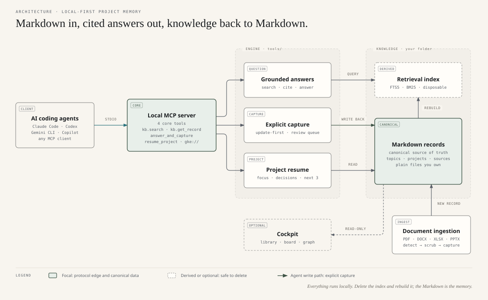

# Grounded Knowledge Engine

[](https://github.com/dimosgit/grounded-knowledge-engine/actions/workflows/ci.yml)
[](LICENSE)

**Local-first, provider-neutral project memory for AI coding agents.**

Grounded Knowledge Engine (GKE) gives Claude Code, Codex, Gemini CLI, and other
MCP clients durable context across sessions. It retrieves evidence from local
files, answers with file-and-line citations, retains useful learning back into
Markdown, and resumes structured project state without turning a database or
hosted service into the source of truth.

Your Markdown remains canonical. Retrieval indexes are derived and disposable,
and every workspace stays on your machine.

https://github.com/user-attachments/assets/d00c977b-9538-4835-94d5-26350136eb34

## What GKE does

- **Grounded answers** with file-and-line citations and strict abstention.
- **Durable capture** back into Markdown; risky changes enter a review queue.
- **Project resume** as a cited briefing: focus, decisions, blockers, next steps.
- **Document ingestion** for PDF, DOCX, XLSX, PPTX, HTML, and more.
- **One local MCP server** for Claude Code, Codex, Gemini CLI, and Copilot.

It is not a hosted chat memory, team wiki, or document-management platform.

## Quick start

GKE requires **Node 22.5 or newer**; Node 24 is recommended.

Install the current release:

```bash
npm install --global https://github.com/dimosgit/grounded-knowledge-engine/releases/download/v0.2.2/grounded-knowledge-engine-0.2.2.tgz
```

Create the verified demo workspace and configure supported clients:

```bash
gke demo
cd gke-demo
gke setup
```

Restart Claude Code or Codex from `gke-demo`, then ask:

```text
Use GKE to resume the router-rollout project.
```

Continue with the
[five-minute golden path](docs/tutorials/five-minute-golden-path.md) to retrieve
cited evidence, retain one learning, and retrieve it again from a fresh
session.

## The core loop

<picture>
  <source media="(prefers-color-scheme: dark)" srcset="docs/architecture-overview-dark.svg">
  
</picture>

Index or ingest local evidence, answer with citations, capture what was learned
back into Markdown, and resume the project in a later session.

## MCP surface

The default `core` profile exposes four tools: `kb.search`, `kb.get_record`,
`kb.answer_and_capture`, and `kb.resume_project`. When writes are enabled,
retention is automatic and update-first: when the agent establishes a finding
the knowledge base lacked, it is appended to the record that owns it, without
asking first. The demo and default workspaces enable writes; named workspaces
start with writes disabled. The `full` profile adds
advanced retrieval, decisions, and explicit write tools. See the
[MCP server reference](tools/kb-mcp-server/README.md).

## Your own workspace and documents

```bash
gke setup --workspace client-alpha --workspace-root "/path/to/client-alpha"
npm run ingest -- ./inbox --dry-run
```

Each named workspace runs as its own process, with writes disabled by default.
See [workspace configuration](docs/workspace-config.md) and the
[ingestion guide](tools/ingest/README.md).

## Operator Cockpit

An optional local view for project attention, capture and decision review, and
a context graph. Try the [public demo](https://gke.dimouzunov.com) or read the
[Cockpit guide](apps/cockpit/README.md).

## Learn more

[Golden path](docs/tutorials/five-minute-golden-path.md) ·
[Boundaries](docs/separation-of-concerns.md) ·
[Data model](docs/workspace-data-architecture.md) ·
[Copilot](docs/integrations/github-copilot.md) ·
[Agent workflows](docs/agent-workflows.md) ·
[Contributing](CONTRIBUTING.md)

## License

[MIT](LICENSE). The demo knowledge base includes paraphrased notes from the
MIT-licensed MCP documentation; see [demo sources](docs/demo-sources.md).
